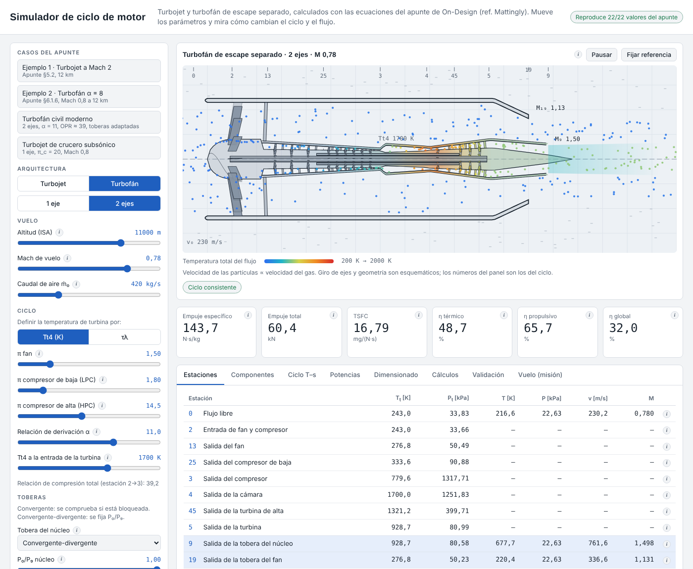
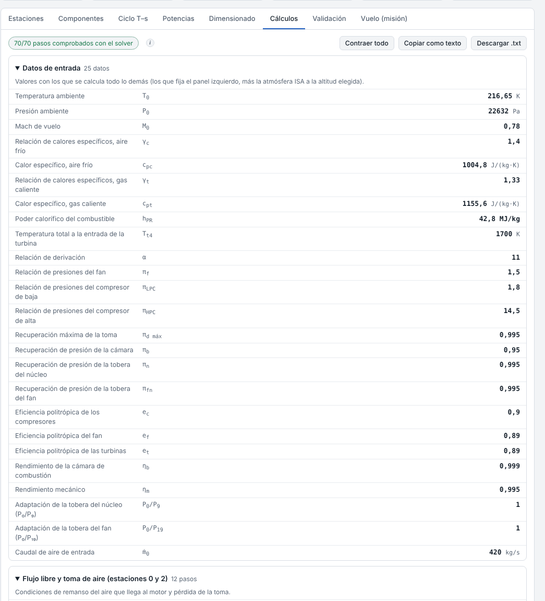
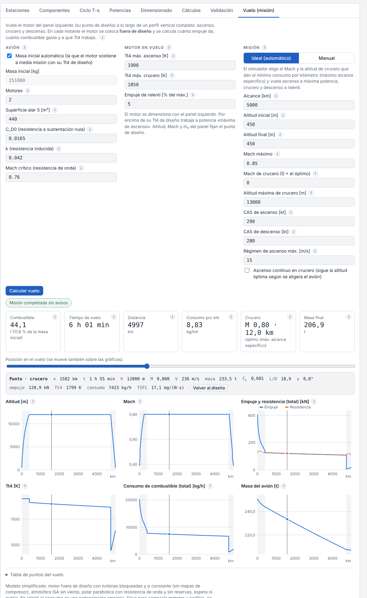

# Simulador de ciclo de motor de aviación

**Web:** [https://adriamartos.github.io/Aircraft-Engine-Simulation-Analysis/](https://adriamartos.github.io/Aircraft-Engine-Simulation-Analysis/) · **Repositorio:** [AdriaMartos/Aircraft-Engine-Simulation-Analysis](https://github.com/AdriaMartos/Aircraft-Engine-Simulation-Analysis)

Aplicación web para estudiar el ciclo de los motores de reacción. Eliges el motor, cambias las condiciones de vuelo y los parámetros de diseño, y ves a la vez:

- el **motor animado** (corte longitudinal) reaccionando a cada cambio,
- los **resultados**: empuje, consumo específico (TSFC) y rendimientos,
- todos los **cálculos del ciclo**: estaciones, componentes, diagrama T–s, potencias, dimensionado y una **memoria de cálculo** con cada ecuación sustituida,
- una **simulación de vuelo** completa (ascenso, crucero y descenso) con el motor trabajando fuera de diseño,
- un modo **Analizar un motor**, que guía paso a paso el estudio de un turbofán real a partir de sus datos y del mapa de su compresor de alta.

Está creada para estudiar y entender mejor cómo funcionan los motores de reacción.



> **Qué es riguroso y qué no.** Los números del ciclo de diseño reproducen los ejemplos resueltos de referencia (Mattingly). La simulación de vuelo usa un modelo fuera de diseño simplificado (sin mapas de compresor) y la animación es esquemática. Ver [Limitaciones](#16-limitaciones).

---

## Índice

1. [Guía rápida](#1-guía-rápida)
2. [Qué hay en pantalla](#2-qué-hay-en-pantalla)
3. [Parámetros del motor](#3-parámetros-del-motor)
4. [Gas, combustible y τλ](#4-gas-combustible-y-τλ)
5. [Resultados: tarjetas y pestañas](#5-resultados-tarjetas-y-pestañas)
6. [Memoria de cálculo](#6-memoria-de-cálculo)
7. [Simulación de vuelo (misión)](#7-simulación-de-vuelo-misión)
7b. [Analizar un motor](#7b-analizar-un-motor)
8. [Casos de ejemplo (presets)](#8-casos-de-ejemplo-presets)
9. [Modelo de cálculo del ciclo](#9-modelo-de-cálculo-del-ciclo)
10. [Modelo fuera de diseño](#10-modelo-fuera-de-diseño)
11. [Casos críticos: errores](#11-casos-críticos-errores)
12. [Casos críticos: avisos](#12-casos-críticos-avisos)
13. [Situaciones que conviene conocer](#13-situaciones-que-conviene-conocer)
14. [Cómo sacarle partido](#14-cómo-sacarle-partido)
15. [Validación y pruebas](#15-validación-y-pruebas)
16. [Limitaciones](#16-limitaciones)
17. [Trabajar con el repositorio](#17-trabajar-con-el-repositorio)
18. [Uso del solver desde código](#18-uso-del-solver-desde-código)
19. [Siguientes pasos](#19-siguientes-pasos)

---

## 1. Guía rápida

1. Abre la web (enlace de arriba). Funciona en ordenador, tablet y móvil, con tema claro u oscuro según el sistema.
2. Arranca con un **turbofán civil moderno** (2 ejes, α = 11, OPR ≈ 39, Mach 0,78 a 11 km). Si quieres partir de los ejemplos resueltos, pulsa un caso en **Casos de ejemplo**.
3. Mueve cualquier deslizador del panel izquierdo: todo se recalcula al instante.
4. Pulsa la **«i»** de cualquier parámetro, tarjeta o fila para ver qué significa, su fórmula y el valor actual explicado.
5. Para estudiar el efecto de un parámetro: pulsa **Fijar referencia**, cambia el parámetro y las tarjetas mostrarán la diferencia en % respecto a la referencia.
6. En la pestaña **Cálculos** tienes todo el desarrollo con números. **Copiar como texto** o **Descargar .txt** lo exportan.
7. En **Vuelo (misión)** pulsa **Calcular vuelo** para volar ese motor en un avión de 2 motores tipo fuselaje ancho.

> El estado **no se guarda** al recargar la página. Si quieres conservar un caso, apunta los parámetros o exporta la memoria de cálculo, que lleva todos los datos de entrada.

---

## 2. Qué hay en pantalla

| Zona | Contenido |
|---|---|
| **Cabecera** | Chip verde «Reproduce 22/22 valores de referencia»: al abrir la página se recalculan los ejemplos resueltos y se comparan (ver pestaña *Validación*). |
| **Panel izquierdo** | Casos de ejemplo, arquitectura, vuelo, ciclo, toberas, nivel tecnológico, ajuste fino de eficiencias y gas/combustible. |
| **Corte animado** | Motor con las estaciones (0, 2, 13, 25, 3, 4, 45, 5, 9, 19), Tt4, Mach de salida de las toberas y velocidad de vuelo v₀. Botones *Pausar* y *Fijar referencia*. |
| **Chips de estado** | Verde «Ciclo consistente», amarillo para avisos y rojo cuando el ciclo no es viable (secciones [11](#11-casos-críticos-errores) y [12](#12-casos-críticos-avisos)). |
| **Seis tarjetas** | Empuje específico, empuje total, TSFC, η térmico, η propulsivo y η global. |
| **Pestañas** | Estaciones, Componentes, Ciclo T–s, Potencias, Dimensionado, Cálculos, Validación y Vuelo (misión). |

**Ayuda contextual.** El botón «i» (círculo gris) aparece en cada parámetro, tarjeta, fila de tabla, gráfica y bloque de la misión: unos 130 textos en total. Se cierra con la × o con Esc. En el diagrama T–s y en las gráficas de la misión, al pasar el cursor por un punto se ven sus valores.

---

## 3. Parámetros del motor

### Arquitectura

| Control | Opciones | Efecto |
|---|---|---|
| Tipo | **Turbojet** / **Turbofán** de escape separado | En turbojet desaparecen fan, α y la tobera del fan. |
| Ejes | **1 eje** / **2 ejes** | Con 1 eje hay un único compresor (π_c). Con 2 ejes, compresor de baja (LPC) y de alta (HPC), y dos turbinas: la de alta mueve el HPC y la de baja mueve el fan y el LPC. |

### Vuelo y ciclo (valores por defecto: turbofán civil moderno)

| Parámetro | Símbolo | Rango | Por defecto | Notas |
|---|---|---|---|---|
| Altitud | h | 0 – 15 000 m | 11 000 m | Atmósfera ISA. Los dos ejemplos resueltos imponen sus T₀ y P₀; mover la altitud vuelve a ISA. |
| Mach de vuelo | M₀ | 0 – 1 (turbofán) · 0 – 2,5 (turbojet) | 0,78 | Al pasar a turbofán con M₀ > 1 se recorta a 1. |
| Caudal de aire | ṁ₀ | 10 – 1500 kg/s | 420 kg/s | Solo escala empuje total, potencias y áreas. No cambia ningún valor específico (F/ṁ₀, TSFC, η). |
| π compresor (1 eje) | π_c | 2 – 60 | 36 | Compresión total 2→3. Con turbofán de 1 eje incluye el fan. |
| π fan | π_f | 1,1 – 3 | 1,5 | Solo turbofán. |
| π compresor de baja | π_LPC | 1 – 6 | 1,8 | Solo 2 ejes. |
| π compresor de alta | π_HPC | 2 – 30 | 14,5 | Solo 2 ejes. Debajo se muestra el OPR = π_f·π_LPC·π_HPC. |
| Relación de derivación | α | 0,5 – 16 | 11 | Solo turbofán. Caudal del bypass / caudal del núcleo. |
| Temperatura de turbina | Tt4 | 1000 – 2100 K | 1700 K | Por encima de 2000 K aparece el aviso de materiales. |
| Parámetro térmico (alternativo) | τλ | 2 – 14 | — | Ver [sección 4](#4-gas-combustible-y-τλ). |

### Toberas

| Parámetro | Opciones / rango | Por defecto | Notas |
|---|---|---|---|
| Tobera del núcleo | Convergente-divergente / Convergente | Conv.-div. | La convergente se calcula con hipótesis y comprobación de bloqueo. |
| P₀/P₉ (núcleo) | 0,2 – 1 | 1 (adaptada) | Solo conv.-div. Menor que 1 → subexpandida (P₉ > P₀). |
| Tobera del fan | Convergente-divergente / Convergente | Conv.-div. | Solo turbofán. |
| P₀/P₁₉ (fan) | 0,2 – 1 | 1 (adaptada) | Solo conv.-div. |

### Componentes: nivel tecnológico (Tabla 3.3, ref. Mattingly)

Los botones **N1 – N4** rellenan de golpe todas las eficiencias y pérdidas. Si la Tt4 actual supera el máximo del nivel, se baja a ese máximo.

| Nivel | Tt4 máx. | π_d máx | e_c | e_f | e_t | π_b | η_b | η_m | π_n |
|---|---|---|---|---|---|---|---|---|---|
| N1 | 1110 K | 0,90 | 0,80 | 0,78 | 0,80 | 0,90 | 0,88 | 0,95 | 0,95 |
| N2 | 1390 K | 0,95 | 0,84 | 0,82 | 0,83 | 0,92 | 0,94 | 0,97 | 0,97 |
| N3 (1985–2005) | 1780 K | 0,98 | 0,88 | 0,86 | 0,87 | 0,94 | 0,99 | 0,99 | 0,98 |
| N4 (actual, por defecto) | 2000 K | 0,995 | 0,90 | 0,89 | 0,89 | 0,95 | 0,999 | 0,995 | 0,995 |

### Ajuste fino de eficiencias (rango 0,7 – 1 en todas)

| Parámetro | Qué es |
|---|---|
| π_d máx | Recuperación de presión total máxima de la toma (sin ondas de choque). |
| e_c, e_f, e_t | Eficiencias politrópicas de compresores, fan y turbinas. |
| π_b | Recuperación de presión total en la cámara de combustión. |
| η_b | Rendimiento de la combustión (fracción de h_PR que se aprovecha). |
| η_m | Rendimiento mecánico de los ejes. |
| π_n núcleo, π_n fan | Recuperación de presión total en cada tobera. |

---

## 4. Gas, combustible y τλ

Desplegable **Gas y combustible** del panel izquierdo:

| Campo | Rango admitido | Por defecto |
|---|---|---|
| γ aire frío (γ_c) | 1,2 – 1,5 | 1,4 |
| c_p aire frío (c_pc) | 900 – 1300 J/(kg·K) | 1004,8 |
| γ gas caliente (γ_t) | 1,2 – 1,45 | 1,33 |
| c_p gas caliente (c_pt) | 1000 – 1500 J/(kg·K) | 1155,6 |
| h_PR | 10 – 125 MJ/kg | 42,8 |

- **Combustible:** el selector rellena h_PR con queroseno (42,8 MJ/kg), Jet A-1 (43,15), metano/GNL (50), hidrógeno (120) o etanol (26,8). Si escribes otro valor, el selector pasa a «Personalizado».
- Un valor fuera de rango pone el campo en rojo y **no se aplica**. «Restablecer valores por defecto» vuelve a la tabla.
- Las constantes de gas se calculan con R = (γ−1)/γ · c_p.
- Con hidrógeno o metano, los gases de escape llevan más vapor de agua y γ_t y c_pt cambian algo. El simulador no los ajusta solo: cámbialos tú si necesitas precisión.

**τλ.** En *Ciclo* puedes definir la temperatura de turbina «por Tt4» o «por τλ», con τλ = c_pt·Tt4/(c_pc·T₀). En modo τλ aparece su deslizador y debajo la Tt4 resultante. Con τλ fijo, la Tt4 cambia sola al cambiar la altitud (porque cambia T₀). Al cambiar de modo se conserva el valor equivalente.

---

## 5. Resultados: tarjetas y pestañas

### Tarjetas

| Tarjeta | Unidad | Definición |
|---|---|---|
| Empuje específico | N·s/kg | F/ṁ₀, por kg/s de aire total. |
| Empuje total | kN | (F/ṁ₀)·ṁ₀. |
| TSFC | mg/(N·s) | f / ((1+α)·F/ṁ₀). La «i» da también el valor en kg/(kN·h). |
| η térmico | % | (1+α)·Δe_k / (f·h_PR). |
| η propulsivo | % | v₀·(F/ṁ₀) / Δe_k. |
| η global | % | η_T·η_P. |

Con una referencia fijada, cada tarjeta muestra la variación en % (▲ verde si mejora, ▼ rojo si empeora). Si un rendimiento no está definido (ver [sección 12](#12-casos-críticos-avisos)), la tarjeta muestra «–».

### Pestañas

| Pestaña | Contenido |
|---|---|
| **Estaciones** | T_t y P_t de cada estación; T, P, v y M estáticos en el flujo libre y en las salidas de tobera. |
| **Componentes** | π y τ de toma, fan, LPC, HPC, cámara, turbinas y toberas, con la eficiencia usada; f y τλ; F_R. |
| **Ciclo T–s** | Diagrama temperatura–entropía (núcleo continuo, bypass discontinuo) con puntos interactivos. |
| **Potencias** | Trabajo específico (kJ/kg de aire del núcleo) y potencia (MW) de fan, compresores y turbinas: comprueba visualmente el balance de potencias. |
| **Dimensionado** | Área, Mach y radio de punta de cada estación; caudales de núcleo, bypass y combustible. |
| **Cálculos** | Memoria de cálculo completa ([sección 6](#6-memoria-de-cálculo)). |
| **Validación** | 22 valores del simulador frente a los ejemplos resueltos de referencia, con su error. |
| **Vuelo (misión)** | Simulación de vuelo ([sección 7](#7-simulación-de-vuelo-misión)). |

---

## 6. Memoria de cálculo



La pestaña **Cálculos** desarrolla todo el ciclo en el orden en que se calcula. Cada fila muestra la magnitud, su **fórmula**, la **sustitución con los números actuales** y el **resultado**:

1. **Datos de entrada**, incluida la atmósfera ISA a la altitud elegida.
2. **Flujo libre y toma:** R_c, R_t, a₀, v₀, τ_r, π_r, η_r, π_d y las estaciones 0 y 2.
3. **Compresión:** τ de fan, LPC y HPC (o compresor único), OPR y estaciones 13, 2.5 y 3.
4. **Cámara:** τλ, f y P_t4.
5. **Turbinas:** balance de potencias (eq. 6.5 en 1 eje; 6.10 y 6.11 en 2 ejes), π_t y estaciones 4.5, 5 y 9.
6. **Toberas:** presión, Mach, temperatura y velocidad de salida (adaptada o convergente con comprobación de bloqueo) y empuje específico del núcleo y del fan.
7. **Prestaciones:** F/ṁ₀, TSFC, Δe_k, η_T, η_P, η_O y F_R.
8. **Caudales y áreas:** ṁ_c, ṁ_s, ṁ_f, F y área de cada estación con el parámetro de flujo másico (MFP, eq. 11.4).

Cada resultado se **recalcula en la propia hoja** a partir de los números de la sustitución y se compara con el solver. El chip de arriba (por ejemplo «70/70 pasos comprobados con el solver») se pondría rojo y marcaría la fila si alguno no coincidiera. Se muestran 5 cifras significativas; el cálculo interno usa toda la precisión. La hoja se adapta a la arquitectura: turbojet o turbofán, 1 o 2 ejes, y toberas adaptadas o convergentes.

- **Copiar como texto** / **Descargar .txt**: exportan la hoja entera con una cabecera del caso.
- **Contraer todo / Expandir todo**: pliega las secciones.
- Si eliges un punto de vuelo en la misión, la hoja muestra el ciclo **en ese punto** (fuera de diseño), y las π y la Tt4 de ese punto aparecen como datos de entrada.

---

## 7. Simulación de vuelo (misión)



La pestaña **Vuelo (misión)** toma el motor del panel izquierdo, dimensionado en su **punto de diseño** (altitud, Mach, ṁ₀, π, α y Tt4), y lo vuela en un perfil vertical completo. En cada instante resuelve el equilibrio de fuerzas del avión y calcula la Tt4 que necesita el motor **fuera de diseño**.

### Parámetros

**Avión** (por defecto, un bimotor de fuselaje ancho):

| Parámetro | Rango | Por defecto | Notas |
|---|---|---|---|
| Masa inicial automática | sí/no | sí | Masa que el motor sostiene en vuelo nivelado, en su punto de diseño y con su Tt4 de diseño, a media misión. |
| Masa inicial | 5000 – 600 000 kg | 251 000 (automática) | Editable si desmarcas la masa automática. |
| Motores | 1 – 4 | 2 | |
| Superficie alar S | 50 – 900 m² | 440 | |
| C_D0 | 0,008 – 0,05 | 0,0165 | Resistencia con sustentación nula. |
| k | 0,02 – 0,1 | 0,042 | Resistencia inducida: C_D = C_D0 + k·C_L². |
| Mach crítico | 0,6 – 0,9 | 0,76 | Por encima aparece la resistencia de onda 20·(M − M_crit)⁴. |

**Motor en vuelo:**

| Parámetro | Rango | Por defecto | Notas |
|---|---|---|---|
| Tt4 máx. ascenso | 1400 – 2100 K | 1900 K | Potencia máxima en el ascenso. |
| Tt4 máx. crucero | 1400 – 2100 K | 1850 K | Límite que debe respetar el crucero. |
| Empuje de ralentí | 1 – 15 % del máximo | 5 % | Empuje en el descenso. |

**Misión – modo Ideal (automático):**

| Parámetro | Rango | Por defecto |
|---|---|---|
| Alcance | 300 – 14 000 km | 5000 km |
| Altitud inicial / final | 0 – 3000 m | 450 m / 450 m |
| Mach máximo | 0,6 – 0,95 | 0,85 |
| Mach de crucero (0 = el óptimo) | 0 – 0,95 | 0 |
| Altitud máxima de crucero | 7000 – 15 000 m | 13 000 m |
| CAS de ascenso / descenso | 200 – 350 kt | 290 / 280 kt |
| Régimen de ascenso máximo | 5 – 40 m/s | 15 m/s |
| Ascenso continuo en crucero | sí/no | no |

**Misión – modo Manual:** tabla de puntos de ruta (distancia en km, altitud en m y Mach). Se pueden añadir y borrar puntos, y **Copiar el perfil ideal** convierte el último vuelo ideal en puntos editables. También se elige qué potencia máxima tiene disponible el motor: la de ascenso o la de crucero.

Un campo fuera de rango se pone en rojo y no se aplica. Si cambias algo después de calcular, aparece un aviso de resultados desactualizados hasta que vuelvas a pulsar **Calcular vuelo**.

### Cómo vuela el perfil ideal

1. **Ascenso** a máxima potencia (limitado por el régimen de ascenso máximo) a CAS constante y, al llegar al Mach de crucero, a Mach constante. Por debajo de 10 000 ft la CAS se limita a 250 kt.
2. **Crucero óptimo:** busca el Mach y la altitud con el máximo **alcance específico** (km por kg de combustible). Respeta el Mach máximo, la altitud máxima y la Tt4 de crucero, y exige un margen de ascenso de 1,5 m/s (techo de servicio). Se itera con la masa media del crucero. Con *ascenso continuo* el avión sube poco a poco siguiendo la altitud óptima a medida que se aligera.
3. **Descenso** a ralentí. El punto de inicio del descenso se itera para que el vuelo acabe exactamente en el alcance pedido.

### Perfil manual

Entre dos puntos, la altitud y el Mach varían linealmente. En cada tramo se calcula el empuje necesario (resistencia + componente del peso + aceleración) y la Tt4 que hace falta. Si el motor no llega, se avisa qué tramo no se puede volar. Si el descenso pedido es más empinado que el de ralentí, se avisa de que harían falta aerofrenos.

### Resultados

- **Tarjetas:** combustible (t y % de la masa inicial), tiempo, distancia, consumo por km, Mach y altitud de crucero, y masa final.
- **Seis gráficas** frente a la distancia: altitud, Mach, empuje y resistencia, Tt4, consumo y masa. Las bandas sombreadas son el ascenso y el descenso.
- **Barra de posición:** al moverla o al pasar el cursor por una gráfica, una línea marca el punto en todas, se muestran sus datos (V, C_L, L/D, γ, empuje, Tt4, consumo y TSFC) y **el motor animado y todas las pestañas pasan a ese punto de vuelo**. *Volver al diseño* lo deshace.
- **Tabla de puntos** del vuelo, desplegable.

### Física

- **Dinámica:** T − D = W·sin γ·(1 + (V/g)·dV/dh) en ascenso y descenso con programa de velocidad (método de energía); T = D en crucero.
- **Atmósfera:** ISA sin viento. CAS ↔ Mach con las relaciones compresibles.
- **Motor:** modelo fuera de diseño de la [sección 10](#10-modelo-fuera-de-diseño), escalado por el número de motores.
- **Integración** en el tiempo: la masa baja con el combustible quemado.

---

## 7b. Analizar un motor

Arriba a la derecha, el selector **Explorar el ciclo / Analizar un motor** cambia de modo. El modo de análisis es un recorrido por pasos para estudiar un turbofán real de 2 ejes. Cada paso empieza con un desplegable **«Qué se hace en este paso y por qué»** que explica la teoría con las ecuaciones que se usan.

| Paso | Contenido |
|---|---|
| 1 · Datos del motor | Crucero (h₀, M₀), α, OPR, π_f, Tt4, combustible, eficiencias, toberas, gas y **mapa del compresor de alta**. Junto a cada dato hay un campo **«Fuente o supuesto»** para anotar de dónde sale. |
| 2 · Punto de diseño | Ciclo resuelto en crucero: F, F/ṁ₀, TSFC, η_T, η_P, η_O; estaciones, componentes, potencias, T–s y memoria de cálculo exportable. Botón para abrir el motor en el explorador (animación y misión). |
| 3 · Mapas de calor | F, TSFC, η_T, η_P, η_O, F/ṁ₀ o ṁ₀ en una rejilla π_LPC × π_HPC, con el punto de diseño marcado y dos escenarios: (i) ṁ_core y η_HPC fijos; (ii) ṁ_c,25 y η_HPC siguiendo la línea de operación del mapa. Escala de color por mapa o compartida, valores al pasar el cursor y descarga en .csv. |
| 4 · Compresor de alta | Etapas repetidas (*repeating-row, repeating-stage*): α₂, U, Ψ, Φ, π y τ por etapa, número de etapas, régimen de giro, áreas y alturas de álabe. Triángulos de velocidades dibujados, figura de diseño recalculada y tabla etapa a etapa. |
| 5 · Turbina de alta | Una etapa, velocidad axial constante y salida sin giro: U necesaria, R_t, α₂, β₂, β₃, Mach y radio medio (mismo eje que el HPC). Comprobaciones α₂ ≤ 70°, M₂ > 1 y M₃R < 0,9. Triángulos y figura de diseño (Ψ/Φ y R_t/Φ). |
| 6 · Fuera de diseño | El mismo motor en otra condición (por defecto nivel del mar y M₀ = 0): iteración con turbinas bloqueadas y α variable. Comparación con el diseño, punto del HPC sobre su mapa y tabla de convergencia. |
| 7 · Resumen | Tablas de datos (con fuentes) y de resultados de todos los pasos, para copiar (separadas por tabuladores) o descargar en .csv. |

**Supuestos por defecto de los pasos 3–6.** Son genéricos y se pueden cambiar en cada paso:

| Paso | Supuesto por defecto |
|---|---|
| 3 | π_LPC entre 1,2 y 6; π_HPC en todo el rango de la línea de operación (1,54–6,90); 31 × 31 puntos. |
| 4 | M₁ = 0,5, α₁ = 30°, D = 0,5, σ = 1, radio medio 0,30 m; e_c equivalente a la η_HPC del mapa (eq. 3.26), así que las N etapas dan exactamente π_HPC. La figura de diseño del enunciado corresponde a D = 0,5, σ = 1 y e_c = 0,9: recalculada con las ecuaciones coincide con ella (α₁ = 0 → α₂ = 36,87°, π de etapa 1,064 a M₁ = 0,3, ωr/V₁ = 0,75). |
| 5 | Ψ = 1,6 (R_t = 0,2) y Φ = 0,65. |
| 6 | Nivel del mar, M₀ = 0, Tt4 = la de diseño + 100 K. τ_tH constante, toberas con garganta de área fija, reparto de potencia fan/LPC constante (*constant power split*). La η_HPC se mantiene en su valor de diseño. |

**Fuera de diseño, cómo se resuelve.** Las incógnitas son τ_f, τ_LPC, τ_tL, α y los Mach de las gargantas de las toberas. Se parte de los valores de diseño y se itera con:
- ṁ_core(1+f)√Tt4/P_t4 = cte (HPT bloqueada);
- π_tL·MFP(M₈)/√τ_tL = cte (tobera del núcleo);
- α = α_D·(P_t19/P_t4)/(P_t19/P_t4)_D·√[(Tt4/Tt19)/(Tt4/Tt19)_D]·MFP(M₁₉)/MFP_D;
- los balances de potencia de los dos ejes.

En la propia condición de diseño, el resultado coincide exactamente con el punto de diseño (comprobado en los tests). A M₀ = 0, η_P y η_O valen 0 por definición.

**Cómo se obtienen π_LPC y el caudal.**
- El HPC sale de su mapa: el punto de diseño da π_HPC, la eficiencia **isentrópica** η_HPC y el caudal corregido ṁ_c,25.
- π_LPC = OPR / (π_f · π_HPC).
- Con T_t25 y P_t25 del ciclo: ṁ_core = ṁ_c,25 · δ₂₅ / √θ₂₅ (θ = T_t/T_ref, δ = P_t/P_ref; por defecto 288,15 K y 101 325 Pa) y ṁ₀ = (1 + α) · ṁ_core.
- El HPC usa τ_HPC = 1 + (π_HPC^((γ−1)/γ) − 1)/η_HPC. El resto de componentes usan eficiencias politrópicas.

**Mapa digitalizado.** El mapa del HPC incluido se ha digitalizado calibrando los ejes con la rejilla (error menor de 0,02 en π y en ṁ_c):

| Dato | Valor |
|---|---|
| Punto de diseño | ṁ_c,25 = 20,0 kg/s · π_HPC = 6,59 · η_HPC ≈ 0,85 |
| Línea de operación | π_HPC = 0,3574 · ṁ_c − 0,566, para ṁ_c entre 5,9 y 20,9 kg/s (π_HPC entre 1,54 y 6,90) |
| η_HPC a lo largo de la línea | 0,70 (6,5 kg/s) · 0,75 (7,7) · 0,80 (10,2) · 0,82 (11,6) · 0,83 (12,4) · 0,84 (13,3) · 0,85 entre 15,2 y 20,0 · 0,84 (20,3) · 0,83 (20,6) · 0,82 (20,8) |

Las eficiencias son los cruces de la línea con las isolíneas; entre ellos se interpola linealmente, y dentro de la isolínea de 0,85 se toma 0,85. Si leéis otro valor en la figura original, se puede cambiar en el paso 1.

**Guardar y compartir.** Los datos se guardan automáticamente en el navegador. **Guardar archivo** descarga un `.json` con el motor (datos y fuentes) y **Cargar archivo** lo abre en otro ordenador: así todo el equipo trabaja con los mismos datos. **Empezar de cero** vuelve al motor de ejemplo, cuyos valores son genéricos y hay que sustituir.

**Avisos del paso 1:** π_LPC < 1 (el OPR no llega para π_f y π_HPC) es un error. π_LPC casi 1 y π_HPC fuera del rango de la línea de operación son avisos.

---

## 8. Casos de ejemplo (presets)

| Caso | Datos |
|---|---|
| **Ejemplo 1 · Turbojet a Mach 2** | Ejemplo resuelto. 12 km (T₀ = 216,69 K, P₀ = 19,40 kPa), M₀ = 2, π_c = 10, Tt4 = 1800 K, tobera conv.-div. con P₀/P₉ = 0,5. Gas: c_pc = 1004, γ_t = 1,3, c_pt = 1239. Eficiencias del enunciado. |
| **Ejemplo 2 · Turbofán α = 8** | Ejemplo resuelto. M₀ = 0,8 a 12 km, 1 eje, π_c = 36, π_f = 1,7, Tt4 = 1666,67 K, P₀/P₉ = P₀/P₁₉ = 0,9. Eficiencias del enunciado. |
| **Turbofán civil moderno** (por defecto) | 2 ejes, α = 11, π_f = 1,5, π_LPC = 1,8, π_HPC = 14,5 (OPR ≈ 39), Tt4 = 1700 K, M₀ = 0,78 a 11 km, toberas adaptadas, N4, ṁ₀ = 420 kg/s. |
| **Turbojet de crucero subsónico** | 1 eje, π_c = 20, Tt4 = 1600 K, M₀ = 0,8 a 11 km, tobera adaptada, N4, ṁ₀ = 60 kg/s. |

Los dos primeros reproducen ejemplos resueltos de referencia (Mattingly). Los otros dos son casos genéricos, **no** un motor comercial concreto.

---

## 9. Modelo de cálculo del ciclo

Análisis 1D on-design con **gas calóricamente perfecto** y propiedades distintas antes y después de la cámara (γ_c, c_pc y γ_t, c_pt).

**Hipótesis:** flujo estacionario, unidimensional y adiabático, sin sangrados ni refrigeración. Compresión y expansión con eficiencia politrópica. Pérdidas de presión en toma, cámara y toberas.

**Pasos y ecuaciones:**

1. **Flujo libre:** a₀ = √(γ_c R_c T₀), v₀ = M₀ a₀, τ_r = 1 + (γ_c−1)/2·M₀², π_r = τ_r^(γ_c/(γ_c−1)).
2. **Toma:** π_d = π_d máx · η_r, con η_r = 1 si M₀ ≤ 1; 1 − 0,075(M₀−1)^1,35 si 1 < M₀ < 5; y 800/(M₀⁴ + 935) si M₀ ≥ 5.
3. **Compresores:** τ = π^((γ_c−1)/(γ_c·e)) para fan, LPC y HPC (o compresor único).
4. **Cámara:** τλ = c_pt Tt4/(c_pc T₀) y f = (τλ − τ_r τ_c) / (η_b h_PR/(c_pc T₀) − τλ).
5. **Balance de potencias:**
   - 1 eje: τ_t = 1 − τ_r/(η_m(1+f)τλ) · [(τ_c − 1) + α(τ_f − 1)] (eq. 6.5).
   - 2 ejes: τ_tH = 1 − τ_r τ_f τ_LPC (τ_HPC − 1) / (η_m(1+f)τλ) (eq. 6.10) y τ_tL = 1 − τ_r [(1+α)(τ_f − 1) + τ_f(τ_LPC − 1)] / (η_m(1+f)τλ τ_tH) (eq. 6.11).
   - π_t = τ_t^(γ_t/((γ_t−1)e_t)).
6. **Toberas:**
   - *Convergente-divergente:* P₉ = P₀/(P₀/P₉) y M₉ = √(2/(γ−1)·((P_t9/P₉)^((γ−1)/γ) − 1)).
   - *Convergente:* si P_t9/P₀ ≥ ((γ+1)/2)^(γ/(γ−1)), está bloqueada (M₉ = 1 y P₉ > P₀); si no, sale a P₀.
   - T₉ = T_t/(1 + (γ−1)/2·M₉²) y v₉ = M₉√(γ R T₉).
7. **Empuje** por kg/s de cada corriente: F_núcleo = (1+f)v₉ − v₀ + (1+f)R_t T₉/v₉·(1 − P₀/P₉), y lo mismo en el fan sin el término f. F/ṁ₀ = (F_núcleo + α F_fan)/(1+α).
8. **Prestaciones:** TSFC = f/((1+α)F/ṁ₀); Δe_k = ½[(1+f)/(1+α)·v₉² + α/(1+α)·v₁₉² − v₀²]; η_T = (1+α)Δe_k/(f h_PR); η_P = v₀(F/ṁ₀)/Δe_k; η_O = η_T η_P.
9. **Dimensionado:** A = ṁ√(R T_t)/(MFP(M)·P_t), con MFP(M) = √γ·M·(1 + (γ−1)/2·M²)^(−(γ+1)/(2(γ−1))). Mach de diseño: M₂ = 0,5, M₃ = 0,30, M₄ = 0,25 y M₅ = 0,45; en las toberas, el Mach calculado.

---

## 10. Modelo fuera de diseño

Lo usa la simulación de vuelo. Es una **aproximación de curso**, no un análisis con mapas de componentes:

- Las turbinas trabajan con la tobera de entrada **bloqueada**, así que τ_tH y τ_tL (o τ_t) se mantienen en su valor de diseño.
- **α** y todas las **eficiencias** se mantienen en su valor de diseño. En 2 ejes también se mantiene el reparto de trabajo entre fan y LPC.
- Para una Tt4 y unas condiciones de vuelo dadas, el balance de potencias da cuánto comprime cada compresor (fórmula cerrada) y se itera f.
- El caudal sale del bloqueo de la turbina de alta: ṁ₄·√Tt4 / P_t4 = constante. Por eso el caudal y el empuje suben a nivel del mar y bajan en altitud.
- Las toberas conv.-div. se suponen adaptadas fuera del punto de diseño.
- **En el punto de diseño reproduce exactamente** el empuje, el TSFC y el caudal del panel (está comprobado en los tests).
- **Ralentí:** a muy baja Tt4 el ciclo simplificado no tiene solución. Entonces el consumo se extrapola con ṁ_f ∝ F^0,7 desde el último punto resoluble, y el empuje se limita por abajo al % de ralentí.

---

## 11. Casos críticos: errores

Si los parámetros no dan un ciclo físicamente posible, el simulador **no calcula**: aparece un chip rojo con el motivo y las pestañas muestran el mismo mensaje.

| Mensaje | Qué pasa físicamente | Cómo arreglarlo |
|---|---|---|
| *Tt4 (… K) no supera la temperatura de salida del compresor Tt3 (… K): la cámara no puede calentar.* | Tras comprimir, el aire ya está más caliente que la Tt4 pedida. Ocurre con mucha compresión, Mach alto o Tt4 baja. (Como c_pt > c_pc, la fórmula de f podría dar f > 0 aunque Tt4 < Tt3; el simulador lo detecta antes.) | Sube Tt4, o baja la compresión o el Mach. |
| *Tt4 demasiado baja para esta compresión: no hay aporte de combustible (f ≤ 0).* | No hay que añadir combustible para llegar a Tt4. | Igual que el anterior. |
| *Las turbinas no pueden mover compresor y fan con esta Tt4…* | El balance de potencias exigiría τ_t ≤ 0,2: la turbina tendría que extraer casi toda la energía del gas. | Sube Tt4, o baja π_c, π_f o α. |
| *La presión total a la salida del núcleo (… kPa) no supera la de descarga…* | La turbina extrae tanta energía que el gas del núcleo no tiene presión para salir por la tobera. Típico de α y π_f altos a baja altitud y Mach bajo. | Baja α o π_f, o sube Tt4 o el Mach. |
| *La presión total a la salida del fan no supera la de descarga…* | El fan no comprime lo suficiente para vencer la presión ambiente (con las pérdidas de toma y tobera). | Sube π_f o el Mach. |

**Errores de la misión** (chip rojo en la pestaña de vuelo):

| Mensaje | Causa | Qué hacer |
|---|---|---|
| *Masa inicial no válida (≤ 0)…* | Con la masa automática: el empuje del motor en su punto de diseño no cubre ni la resistencia parásita del avión. | Sube ṁ₀ o Tt4, añade motores, o reduce S o C_D0. |
| *No hay ninguna combinación de altitud y Mach con la que el avión pueda cruzar…* | Con esa masa y resistencia, no hay crucero posible con la Tt4 máxima de crucero. | Baja la masa, sube la Tt4 de crucero o mejora la aerodinámica. |
| *El vuelo necesitaría quemar … % de la masa inicial en combustible…* | El avión se quedaría por debajo del 30 % de su masa: imposible. | Reduce el alcance o la resistencia, o mejora el motor. |
| *El motor no tiene solución a esa altitud y velocidad…* / *No se ha podido calcular ningún tramo…* | El motor, tal como está diseñado, no funciona fuera de diseño en esas condiciones (habitual al principio del vuelo, a baja altitud y Mach). | Prueba otro punto de diseño: menos α o más π_f. |
| *El motor no tiene solución en el tramo n.* | (Manual) igual que el anterior, en ese tramo. | Cambia el tramo o el motor. |

---

## 12. Casos críticos: avisos

El cálculo sigue, pero el resultado necesita interpretación (chip amarillo):

| Aviso | Significado |
|---|---|
| *Tobera del núcleo bloqueada (M₉ = 1)* / *del fan (M₁₉ = 1)* | Solo toberas convergentes. La salida queda a P > P₀ y parte del empuje es de presión. |
| *η_P > 100 %* | Toberas no adaptadas. El término de presión (P₉ − P₀)A₉ entra en F pero no en Δe_k, así que con esta definición η_P puede superar 1. **No es un error del programa.** Para comparar rendimientos usa toberas adaptadas (P₀/P₉ = 1). |
| *Δe_k ≤ 0: … η_T, η_P y η_O no están definidos.* | Con toberas muy subexpandidas o un fan lento, el chorro sale con menos energía cinética que el aire de entrada, aunque haya empuje por presión. Las tarjetas de rendimiento muestran «–». |
| *Empuje específico ≤ 0…* | El motor no da empuje. TSFC y rendimientos no tienen sentido y se muestran como «–». |
| *El fan da empuje negativo…* | El chorro frío sale más lento que el vuelo: el fan frena. Sube π_f o baja el Mach. |
| *El núcleo da empuje negativo…* | La turbina extrae casi toda la energía del gas caliente; todo el empuje es del fan. |
| *Tt4 por encima del límite de materiales de la Tabla 3.3 (2000 K)* | Fuera de la tecnología actual sin refrigeración avanzada. |

**Avisos de la misión:**

| Aviso | Significado |
|---|---|
| *Techo de ascenso: con la potencia máxima el avión no puede seguir subiendo…* | No se alcanza la altitud objetivo; el crucero empieza donde se llegó. |
| *Crucero limitado por empuje…* | En algún momento del crucero la resistencia supera el empuje con la Tt4 máxima de crucero. |
| *El combustible es el … % de la masa inicial…* | Por encima del 45 %: un avión real no puede llevar tanto combustible. |
| *Tramo n: el perfil pedido exige más empuje del que da el motor…* | (Manual) ese tramo no se podría volar. |
| *Tramo n: el descenso pedido es más empinado que el de ralentí…* | (Manual) harían falta aerofrenos. |

---

## 13. Situaciones que conviene conocer

- **Mach 0 (estático):** v₀ = 0, así que η_P = η_O = 0 por definición. El empuje y el TSFC se calculan con normalidad.
- **Cambiar la altitud en el panel no es «el mismo motor a otra altitud».** El panel es on-design: cada cambio **rediseña** el motor en esas condiciones. Para ver el *mismo* motor a otra altitud o velocidad, usa la simulación de vuelo y la barra de posición.
- **ṁ₀ no cambia el ciclo:** solo escala el empuje total, las potencias y las áreas.
- **Turbofán limitado a M₀ ≤ 1** y turbojet a M₀ ≤ 2,5. No se modelan ondas de choque en la toma más allá de η_r ni la inestabilidad de toma.
- **Cargar un ejemplo resuelto y mover la altitud:** se abandonan sus T₀ y P₀ y se pasa a ISA.
- **Nivel tecnológico:** al pulsar N1–N4 se sobrescriben las eficiencias que hayas ajustado a mano.
- **Combustibles alternativos:** cambiar h_PR no cambia γ_t ni c_pt automáticamente (ver [sección 4](#4-gas-combustible-y-τλ)).
- **Descargar .txt dentro de claude.ai:** el visor pide confirmación antes de descargar. En GitHub Pages descarga directamente.
- **Reducir movimiento:** si el sistema tiene activado «reducir movimiento», la animación arranca en pausa.

---

## 14. Cómo sacarle partido

- **Estudios paramétricos:** fija una referencia, cambia un solo parámetro (α, π_f, OPR o Tt4) y lee el % de variación en las tarjetas. Las tendencias que da el simulador son las esperables:
  - al subir α baja F/ṁ₀ y baja el TSFC,
  - al subir Tt4 suben F/ṁ₀, η_T y el TSFC,
  - al subir el OPR baja el TSFC,
  - al subir M₀ suben el TSFC y η_P.
- **Repasar la teoría con números:** la pestaña *Cálculos* desarrolla cada ecuación con los valores actuales, útil para seguir el ciclo paso a paso o comprobar un cálculo a mano.
- **Aproximar un motor real:** introduce su α, OPR y caudal. Tt4 y las eficiencias no suelen ser públicas, así que hay que estimarlas.
- **Ver el efecto en el vuelo:** compara el combustible de la misión entre dos diseños del motor con el mismo avión. Desmarca la masa automática y pon la misma masa en los dos casos para que la comparación sea justa.

---

## 15. Validación y pruebas

| Prueba | Qué comprueba | Resultado |
|---|---|---|
| `tests/validate.js` | Solver frente a los ejemplos resueltos de referencia (turbojet y turbofán): τ_r, π_r, π_d, τ_c, τ_f, τλ, f, τ_t, π_t, M₉, M₁₉, F/ṁ₀, TSFC, η_T, η_P, η_O. | 28/28 dentro de tolerancia (error máx. ≈ 0,08 %) |
| `tests/mission.js` | Fuera de diseño = diseño en el punto de diseño; empuje estático plausible; misión ideal, cruise-climb y manual; T = D en crucero; masa monótona; aviso de ascenso imposible. | 14/14 |
| `tests/calcs.js` | Cada paso de la memoria de cálculo coincide con el solver en 39 casos: turbojet y turbofán, 1 y 2 ejes, toberas conv. y conv.-div., M₀ de 0 a 2, más 3 puntos fuera de diseño. | 2257 pasos, todos coinciden |
| `tests/edge.js` | Cada error y aviso de las secciones 11 y 12 aparece cuando toca. | 13/13 |
| `tests/analysis.js` | Mapa del HPC, π_f·π_LPC·π_HPC = OPR, T_t25 y P_t25 iguales al solver, ṁ_c recuperado, η_HPC isentrópica; mapas de calor (la celda de diseño reproduce el diseño); figura de diseño del HPC; U = v₁ + v₂ y producto de etapas = π_HPC; Euler en la HPT; fuera de diseño = diseño en la condición de diseño y convergencia a nivel del mar. | 32/32 |
| Pestaña *Validación* | Los 22 valores principales de los ejemplos, recalculados al abrir la página. | 22/22 |

Durante la revisión también se hicieron barridos que no forman parte de los tests:

- 40 000 combinaciones aleatorias de parámetros en todo su rango: ningún NaN ni excepción, y la memoria de cálculo coincide con el solver en todas.
- 300 estados aleatorios recorriendo todas las pestañas en el navegador: ningún error de JavaScript.
- 120 misiones aleatorias con distintos aviones, motores y perfiles.

Ejecutar todas las pruebas:

```bash
npm test          # ejecuta las 5 baterías de tests/
```

GitHub ejecuta estas pruebas automáticamente en cada *push* y *pull request* (`.github/workflows/tests.yml`). También comprueba que `index.html` esté regenerado a partir de `src/`.

---

## 16. Limitaciones

- **Ciclo on-design.** El fuera de diseño de la misión es una aproximación: turbinas bloqueadas, α y eficiencias constantes, sin mapas de compresor ni línea de operación, sin márgenes de bombeo.
- Solo **turbojet** y **turbofán de escape separado**: no hay flujo mezclado, postcombustión, turboshaft, turboprop ni propfan.
- **Gas calóricamente perfecto** (c_p y γ constantes por zona), sin disociación, refrigeración de álabes ni sangrados.
- **Misión:** atmósfera ISA sin viento; no incluye rodaje, despegue, aproximación, espera ni reservas; polar parabólica genérica; ralentí con ley empírica.
- La **animación** es esquemática: la geometría sale de las áreas del dimensionado, pero las formas y el número de álabes son ilustrativos.
- Los números son una **estimación de ciclo**, no los datos de un motor comercial.
- El estado de la página **no se guarda** al recargar.

---

## 17. Trabajar con el repositorio

### Estructura

```
.
├── index.html                 La web completa (GENERADA a partir de src/; es lo que publica GitHub Pages)
├── src/
│   ├── engine.js              Solver del ciclo y modelo fuera de diseño (navegador y Node)
│   ├── mission.js             Avión, atmósfera e integrador de la misión
│   ├── calcs.js               Memoria de cálculo (fórmula, sustitución y resultado)
│   ├── analysis.js            Modo «Analizar un motor»: mapa del HPC, punto de diseño, mapas de calor, HPC, HPT y fuera de diseño
│   ├── analysis_ui.js         Interfaz del modo de análisis (pasos, campos, mapa)
│   └── template.html          Interfaz, estilos, textos de ayuda «i», dibujo y animación
├── tests/
│   ├── validate.js            Solver frente a los ejemplos resueltos
│   ├── mission.js             Fuera de diseño y misión
│   ├── calcs.js               Memoria de cálculo frente al solver
│   ├── edge.js                Casos críticos (errores y avisos)
│   └── analysis.js            Mapa del HPC, caudal corregido y punto de diseño del análisis
├── docs/                      Capturas del README
├── build.py                   Junta los módulos de src/ en template.html y genera index.html
├── package.json               Atajos: npm test, npm run build
├── .github/workflows/tests.yml  Pruebas automáticas en GitHub
├── LICENSE                    Licencia MIT
└── .nojekyll                  Evita que GitHub Pages procese el sitio con Jekyll
```

### Flujo de trabajo

**Requisitos:** Python 3 y Node.js 18 o superior. No hay dependencias que instalar.

```bash
git clone https://github.com/AdriaMartos/Aircraft-Engine-Simulation-Analysis.git
cd Aircraft-Engine-Simulation-Analysis
# 1. edita src/ (nunca index.html directamente: se sobrescribe)
python3 build.py              # 2. regenera index.html
npm test                      # 3. comprueba que todo sigue bien
python3 -m http.server        # 4. (opcional) prueba en http://localhost:8000
git add -A && git commit -m "Describe el cambio"
git push
```

Para cambios grandes, mejor crear una rama y abrir un *pull request*: así otras personas pueden revisarlo y las pruebas automáticas se ejecutan antes de fusionar.

**Dónde tocar cada cosa:**

| Quiero cambiar… | Archivo |
|---|---|
| Una ecuación del ciclo o un error/aviso | `src/engine.js` (y, si cambia la ecuación, su paso en `src/calcs.js`) |
| El modelo del avión o de la misión | `src/mission.js` |
| Un texto de ayuda «i» | `src/template.html`, objeto `INFO` |
| Rangos o valores por defecto de los deslizadores | `src/template.html`, `BASE`, `SL` y `PRESETS` |
| Valores por defecto de la misión | `src/template.html`, `MSDEF` y `MF_*` |
| El modo de análisis (pasos, textos, mapa) | `src/analysis.js` (cálculo) y `src/analysis_ui.js` (interfaz) |
| Un caso de ejemplo nuevo | `src/template.html`, `PRESETS` (y su validación en `VAL` si tiene valores de referencia) |

### Publicación (GitHub Pages)

La web se publica desde la rama `main`, carpeta raíz: **Settings → Pages → Deploy from a branch → `main` / `(root)`**. Cada *push* a `main` actualiza la web en uno o dos minutos. La página carga las tipografías IBM Plex desde Google Fonts; sin conexión usa las del sistema y todo sigue funcionando.

---

## 18. Uso del solver desde código

`src/engine.js` funciona igual en el navegador que en Node:

```js
const Engine = require('./src/engine.js');
const r = Engine.solve({
  arch: 'turbofan',                                  // 'turbojet' | 'turbofan'
  flight: { T0: 216.65, P0: 22632, M0: 0.78 },        // K, Pa
  gas:    { gc: 1.4, cpc: 1004.8, gt: 1.33, cpt: 1155.6, hPR: 42.8e6 },
  design: { spools: 'two', pif: 1.5, pilpc: 1.8, pihpc: 14.5, alpha: 11, Tt4: 1700 },  // 1 eje: spools 'single' y pic
  comp:   { pidmax: .995, pib: .95, pin: .995, pifn: .995, ec: .9, ef: .89, et: .89, etab: .999, etam: .995 },
  nozzle: { kindCore: 'cd', p0p9: 1, kindFan: 'cd', p0p19: 1 },                     // 'cd' | 'conv'
  size:   { mdot0: 420, M2: 0.5 }
});
// r.ok, r.error, r.warnings, r.Fsp [N·s/kg], r.tsfc [kg/(N·s)], r.etaT, r.etaP, r.etaO,
// τ y π de cada componente, Tt/Pt de cada estación, r.core / r.fan (toberas), r.size (áreas y caudales)
```

- `Engine.isa(h)` → `{ T, P }` de la atmósfera ISA.
- `Engine.makeOffDesign(entrada).at(T0, P0, M0, Tt4)` → el mismo motor fuera de diseño, con `F`, `mdot0` y `mdotf` añadidos.
- `Mission.simulate({ od, ac, eng, ms })` (en `src/mission.js`) → `{ ok, pts, sum, warnings }`. Las entradas y su uso se ven en `tests/mission.js`.
- `Calcs.build(r)` y `Calcs.toText(...)` (en `src/calcs.js`) → la memoria de cálculo de un resultado.

---

## 19. Siguientes pasos

- Más arquitecturas: turbofán de flujo mezclado con postcombustión, turboshaft, turboprop y propfan.
- Fuera de diseño completo con mapas de compresor y línea de operación.
- Mapas de calor de prestaciones en función de π_LPC y π_HPC (o de α y π_f).
- Presets de motores reales a partir de la base de datos ICAO, con Tt4 y eficiencias estimadas.
- Misión: despegue y aproximación, viento, reservas y escalones de crucero.
- Guardar y compartir un caso por enlace (estado en la URL).

---

*Licencia MIT (ver [LICENSE](LICENSE)).*
